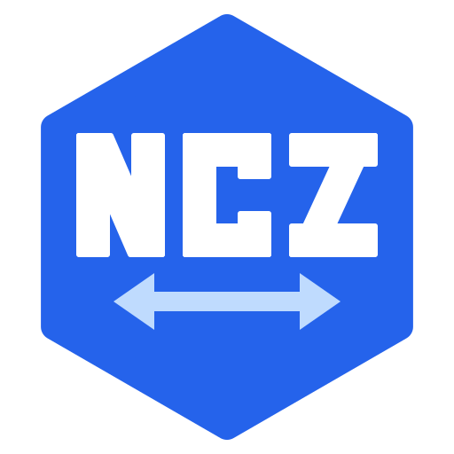
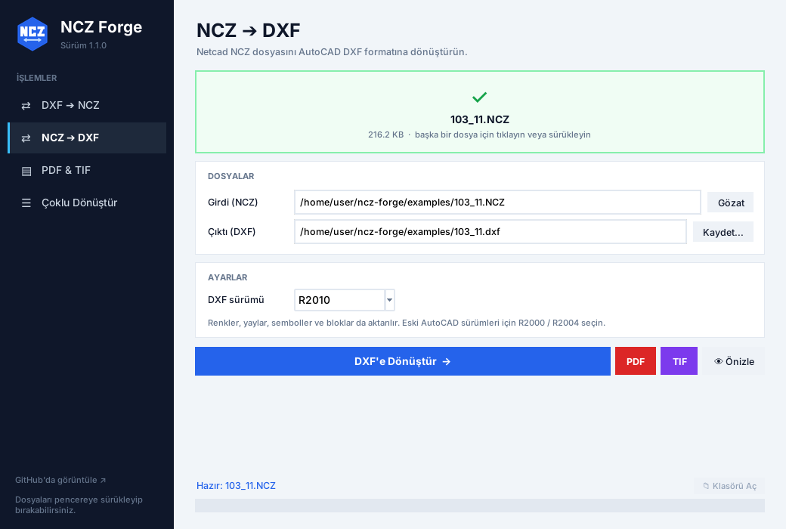
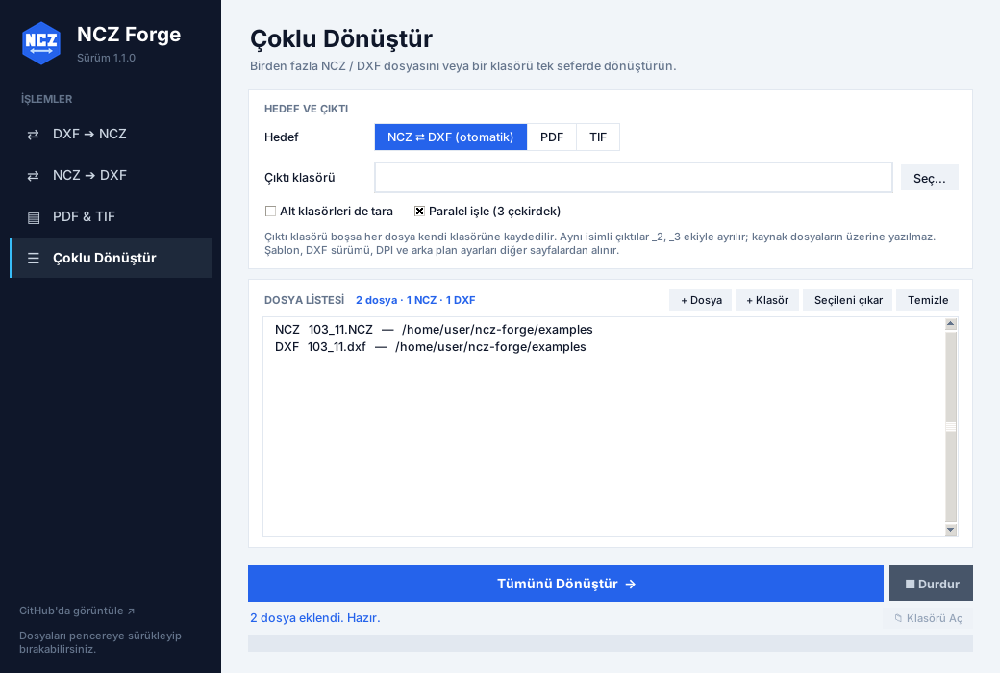

# 🛠️ NCZ Forge

<p align="center">
  
  <br/>
  <b>Netcad NCZ ⮂ AutoCAD DXF Çevirici · Vektör PDF & TIF Dışa Aktarma · Toplu Dönüştürme</b>
  <br/><br/>
  <a href="https://github.com/evrek4/ncz-forge/releases/latest/download/NCZ.Forge.exe">
    
  </a>
  <br/>
  <a href="https://github.com/evrek4/ncz-forge/releases/latest"></a>
  <a href="https://github.com/evrek4/ncz-forge/releases"></a>
  <a href="https://github.com/evrek4/ncz-forge/actions/workflows/tests.yml"></a>
</p>

<p align="center">
  
  
</p>

> 🚀 **Kurulum gerektirmez:** [**NCZ.Forge.exe**](https://github.com/evrek4/ncz-forge/releases/latest/download/NCZ.Forge.exe) dosyasını indirip çift tıklayarak çalıştırın.

> ⚠️ **"Windows bilgisayarınızı korudu" uyarısı:** Exe dijital olarak imzalı olmadığı için Windows SmartScreen bu uyarıyı gösterebilir. **Ek bilgi → Yine de çalıştır** seçeneğiyle açabilirsiniz. Kaynak kodun tamamı bu depodadır; v1.1 ve sonraki sürümlerin exe dosyaları GitHub Actions üzerinde bu koddan otomatik olarak derlenir.

**NCZ Forge**, Netcad'in ikili (binary) formatı olan **.NCZ** dosyalarını okumak, sıfırdan oluşturmak, **AutoCAD DXF** ile iki yönlü dönüştürmek ve yüksek kaliteli **PDF / TIF** çıktıları almak için geliştirilmiş açık kaynaklı ve bağımsız bir araçtır.

<details>
<summary>🇬🇧 <b>English summary</b></summary>

**NCZ Forge** is a free, open-source desktop tool for Netcad's binary **.NCZ** drawing format. It converts **NCZ ⮂ AutoCAD DXF** in both directions (layers, colours, texts, arcs, symbols), exports NCZ/DXF drawings to **vector PDF** and **high-resolution TIFF**, previews drawings, and batch-converts whole folders in parallel. Download the portable Windows exe from the [latest release](https://github.com/evrek4/ncz-forge/releases/latest) — no installation needed — or use the Python command-line tool (`python ncz_tool.py --help`). The UI is in Turkish.
</details>

---

## 🚀 Masaüstü Uygulaması

Sol menüden işlemi seçin; dosyaları pencereye sürükleyip bırakabilir veya tıklayarak seçebilirsiniz.

| Sayfa | Ne yapar? |
|---|---|
| **DXF ➔ NCZ** | AutoCAD DXF çizimini Netcad NCZ'ye dönüştürür. Projeksiyon/stil için şablon NCZ seçilebilir, X/Y yer değiştirilebilir. |
| **NCZ ➔ DXF** | NCZ'yi DXF'e dönüştürür: tabakalar, **tabaka ve nesne renkleri**, yazılar, daireler, **yaylar**, çoklu çizgiler, **semboller ve bloklar**, paftalar. |
| **PDF & TIF** | NCZ veya DXF'i vektör **PDF** ya da LZW sıkıştırmalı **TIF** yapar. 150 / 300 / 600 DPI, beyaz veya siyah arka plan. |
| **Çoklu Dönüştür** | Birden fazla NCZ/DXF dosyasını veya bir klasörü (alt klasörlerle) tek seferde **NCZ ⮂ DXF**, **PDF** ya da **TIF** yapar. İşlemci çekirdeklerini paralel kullanır. |

Diğer özellikler:
* **👁 Önizleme:** Dönüştürmeden önce çizimi yakınlaştırılıp kaydırılabilen bir pencerede görün.
* **Güvenli çıktı:** Var olan bir dosyanın üzerine yazmadan önce sorulur. Toplu dönüştürmede aynı isimli çıktılar `_2`, `_3` eki alır, kaynak dosyalar asla ezilmez.
* **Hata dayanıklılığı:** Toplu dönüştürmede bozuk bir dosya diğerlerini durdurmaz; sonunda hata raporu gösterilir.
* **Güncelleme bildirimi:** Yeni sürüm yayınlandığında sol menüde bildirim çıkar.
* Birden fazla dosya veya klasör sürüklenirse otomatik olarak *Çoklu Dönüştür* sayfası açılır.

---

## 💻 Komut Satırı (CLI)

Kaynak koddan çalıştırmak için Python 3.10+ ve bağımlılıklar:
```bash
pip install -r requirements.txt
```

### Dosya bilgisi
```bash
python ncz_tool.py info examples/103_11.NCZ
```
Netcad sürümünü, projeksiyonu, tabakaları, obje türlerini ve sınır koordinatlarını listeler.

### DXF ➔ NCZ
```bash
python ncz_tool.py dxf2ncz cizim.dxf cizim.NCZ --template examples/103_11.NCZ
```

### NCZ ➔ DXF
```bash
python ncz_tool.py ncz2dxf examples/103_11.NCZ 103_11.dxf --version R2010
```

### PDF ve TIF
```bash
python ncz_tool.py ncz2pdf examples/103_11.NCZ 103_11.pdf
python ncz_tool.py ncz2tif examples/103_11.NCZ 103_11.tif --dpi 300
python ncz_tool.py dxf2pdf examples/103_11.dxf 103_11.pdf
python ncz_tool.py dxf2tif examples/103_11.dxf 103_11.tif --dpi 600 --bg black
```

### Çoklu (toplu) dönüştürme
```bash
# NCZ'ler DXF'e, DXF'ler NCZ'ye (uzantıya göre otomatik)
python ncz_tool.py batch a.NCZ b.NCZ c.dxf --out cikti

# Bir klasördeki tüm NCZ / DXF dosyaları, alt klasörler dahil, PDF olarak
python ncz_tool.py batch proje_klasoru --recursive --to pdf
```
Seçenekler: `--to auto|pdf|tif`, `--out`, `--recursive`, `--jobs N` (paralel süreç sayısı; 0 = otomatik, 1 = sıralı), `--template`, `--swap-xy`, `--version`, `--dpi`, `--bg`.

### Yeniden encode (doğrulama)
```bash
python ncz_tool.py reencode examples/103_11.NCZ yeniden.NCZ
```

---

## 🧪 Geliştirme

```bash
pip install -r requirements-dev.txt
python -m pytest -q tests        # testler
python nczforge.py               # arayüzü kaynak koddan başlat
```

**Yeni sürüm yayınlama:** `version.py` içindeki `__version__` değerini artırın, commit'leyin ve aynı numarayla bir etiket gönderin:
```bash
git tag v1.1.0
git push origin v1.1.0
```
GitHub Actions testleri çalıştırır, Windows exe'yi derler ve **NCZ.Forge.exe** olarak yeni Release'e ekler (`.github/workflows/release.yml`).

---

## 🛠️ Python Kütüphanesi Olarak Kullanım (`ncz_writer.py`)

Kendi kodunuzda CAD objeleri oluşturup doğrudan `.NCZ` olarak kaydetmek için:

```python
from ncz_writer import NCZWriter

# Şablonlu veya sıfırdan bir writer başlatın:
writer = NCZWriter(template_path="examples/103_11.NCZ")

# Tabaka ekleme:
writer.add_layer("PARSEL", color_code=251)
writer.add_layer("BINA", color_code=4)

# Nokta ekleme (X=Sağa/Easting, Y=Yukarı/Northing):
writer.add_point(x=472500.0, y=4108000.0, z=0.0, layer="NOKTA", name="P1")

# Çizgi ekleme:
writer.add_line(x1=472500.0, y1=4108000.0, x2=472600.0, y2=4108050.0, layer="PARSEL")

# Çoklu çizgi / Poligon ekleme:
writer.add_polygon([
    (472500.0, 4108000.0, 0.0),
    (472600.0, 4108000.0, 0.0),
    (472600.0, 4108100.0, 0.0),
    (472500.0, 4108100.0, 0.0),
], layer="BINA")

# Yazı ekleme:
writer.add_text(x=472550.0, y=4108050.0, text="103/11", height=2.5, rotation_deg=0.0, layer="YAZI")

# Çember ekleme:
writer.add_circle(cx=472550.0, cy=4108050.0, radius=5.0, layer="0")

# NCZ dosyasını derleyip kaydetme:
writer.save("yeni_cizim.NCZ")
```

---

## 🔬 NCZ Dosya Formatının İkili (Binary) Yapısı

NCZ dosyası sıralı bloklardan meydana gelir. Her bloğun başlığı:
1. `block_type`: 1 bayt (uint8)
2. `payload_length`: 4 bayt (uint32 little-endian)
3. `payload`: `payload_length` kadar bayt

### Temel Blok Tipleri:
* **Blok 1 (Dosya Başlığı / Master Index):** Toplam dosya boyutunu, diğer ana blokların (Blok 2, 6, 8, 11, 12, 14, 13, 23) dosya içindeki kesin bayt ofsetlerini, çizimin genel sınır kutusunu (Bounding Box: MinX, MinY, MaxX, MaxY) ve toplam geometri sayısını içerir.
* **Blok 2 (UserInfo):** Netcad dosya başlığı ve kullanıcı bilgisi (`\x06netcad...`).
* **Blok 4 (Visible Extents):** Çizim penceresinin varsayılan görünür limitleri.
* **Blok 6 (Layer Table):** Çizimdeki tüm tabakaların isimleri (`windows-1254` kodlamalı Pascal string), renk indisleri ve durum bayrakları (her kayıt 29 bayttır).
* **Blok 21 (Standart Geometri):** Çizimdeki tüm vektör objelerini tutar:
  * **Tip 1 (Point):** Koordinat, kot, tabaka, renk ve nokta adı.
  * **Tip 2 (Line):** Başlangıç ve bitiş koordinatları (X1, Y1, Z1, X2, Y2, Z2) ve Bounding Box.
  * **Tip 3 (Circle):** Merkez koordinatı ve yarıçap.
  * **Tip 5 (Text):** Ekleme noktası, yazı yüksekliği, radyan cinsinden dönüş açısı ve Türkçe karakter uyumlu (`CP1254`) metin içeriği.
  * **Tip 7 (Multiline / Polyline / Polygon):** Tepe noktası sayısı kadar 24 baytlık `(X, Y, Z)` double kayıtları ve poligon etiketi.

### 📐 Koordinat Dönüşüm Kuralı (Önemli):
* Uluslararası CAD/GIS standardında (DXF, SHP, QGIS) ilk koordinat **X (Sağa / Easting)**, ikinci koordinat **Y (Yukarı / Northing)** şeklindedir.
* Netcad ikili dosyasında `raw_x` **Yukarı (Northing)**, `raw_y` ise **Sağa (Easting)** olarak depolanır.
* `ncz_writer.py` ve `dxf_to_ncz.py` bu dönüşümü otomatik ve kayıpsız (0.00000000 m hata ile) gerçekleştirir.

---

## 📂 DWG Dosyaları Hakkında Not:
DWG Autodesk'in kapalı formatıdır. DWG dosyalarınızı AutoCAD, BricsCAD, ZWCAD, QGIS veya ücretsiz ODA File Converter ile **DXF** formatında kaydedip doğrudan `dxf_to_ncz.py` ile NCZ'ye dönüştürebilirsiniz.
