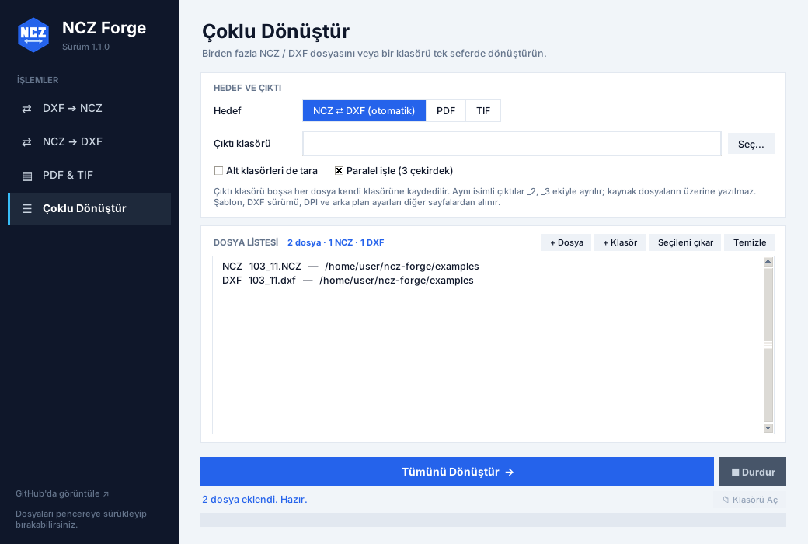

# Batch Conversion

🇹🇷 *Türkçe: [[Çoklu Dönüştürme|Coklu-Donusturme]]*



Use the **Çoklu Dönüştür** page to convert dozens of NCZ / DXF files with one click.

## Steps

1. **Add files**, in one of three ways:
   - Drag files or a folder onto the window.
   - Click **+ Dosya** (*Add files*) and multi-select with Ctrl / Shift.
   - Click **+ Klasör** (*Add folder*) to add every NCZ and DXF in a folder. Tick **Alt klasörleri de tara** (*Include subfolders*) to scan subfolders too.
2. Choose a **Hedef** (*Target*):
   - **NCZ ⮂ DXF (otomatik)**: NCZ files become DXF and DXF files become NCZ. The list may be mixed.
   - **PDF** or **TIF**: everything is exported.
3. **Çıktı klasörü** (*Output folder*, optional): if left empty, each output is saved next to its source file.
4. Press **Tümünü Dönüştür** (*Convert all*).

## Where the settings come from

Batch conversion reuses the settings on the other pages:

| Setting | Taken from |
|---|---|
| NCZ template, swap X/Y | DXF ➔ NCZ |
| DXF version | NCZ ➔ DXF |
| DPI, background colour | PDF & TIF |

## Safety and robustness

- **Source files are never overwritten.** Outputs that would share a name get a `_2`, `_3` suffix.
  *Example:* with `103_11.NCZ` and `103_11.dxf` in the same folder, the PDF target produces `103_11.pdf` and `103_11_2.pdf`.
- **A broken file does not stop the others.** Failed files and the reasons are listed at the end.
- **■ Durdur** (*Stop*) skips files that have not started yet; files already in progress are finished.

## Speed: parallel processing

With **Paralel işle** (*Process in parallel*) ticked, files are converted on several CPU cores at once (one core is left for the interface, at most 8). This is noticeably faster with many files. Untick it if the computer becomes sluggish.

## From the command line

```bash
python ncz_tool.py batch project_folder --recursive --to pdf --out output
```

All options: [[Command Line|Command-Line]].
