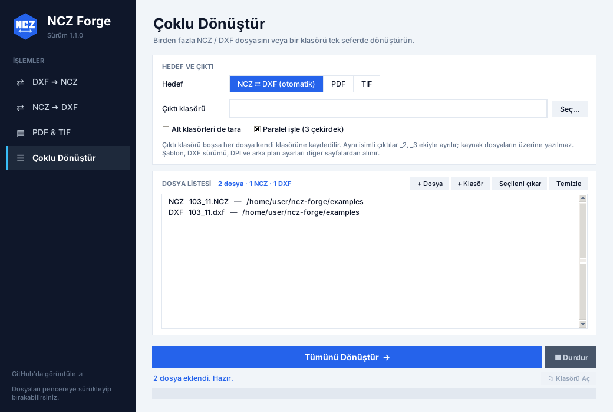

# Çoklu (Toplu) Dönüştürme

🇬🇧 *English: [[Batch Conversion|Batch-Conversion]]*



Onlarca NCZ / DXF dosyasını tek tıkla dönüştürmek için **Çoklu Dönüştür** sayfasını kullanın.

## Adımlar

1. **Dosya ekleyin** — üç yol:
   - Dosyaları veya klasörü pencereye sürükleyip bırakın,
   - **+ Dosya** ile çoklu seçim yapın (Ctrl / Shift ile),
   - **+ Klasör** ile bir klasörün içindeki tüm NCZ ve DXF dosyalarını ekleyin. *Alt klasörleri de tara* işaretliyse alt klasörler de taranır.
2. **Hedef** seçin:
   - **NCZ ⮂ DXF (otomatik):** NCZ'ler DXF'e, DXF'ler NCZ'ye dönüştürülür. Liste karışık olabilir.
   - **PDF** veya **TIF:** Hepsi dışa aktarılır.
3. **Çıktı klasörü** (isteğe bağlı): Boş bırakılırsa her çıktı kendi kaynak dosyasının yanına kaydedilir.
4. **Tümünü Dönüştür** düğmesine basın.

## Ayarlar nereden alınır?

Çoklu dönüştürme, diğer sayfalardaki ayarları kullanır:

| Ayar | Alındığı sayfa |
|---|---|
| NCZ şablonu, X/Y yer değiştirme | DXF ➔ NCZ |
| DXF sürümü | NCZ ➔ DXF |
| DPI, arka plan rengi | PDF & TIF |

## Güvenlik ve dayanıklılık

- **Kaynak dosyaların üzerine asla yazılmaz.** Aynı adı taşıyacak çıktılar `_2`, `_3` ekiyle ayrılır.
  *Örnek:* Aynı klasörde `103_11.NCZ` ve `103_11.dxf` varken PDF hedefi `103_11.pdf` ve `103_11_2.pdf` üretir.
- **Bozuk bir dosya diğerlerini durdurmaz.** İşlem sonunda hatalı dosyalar ve nedenleri listelenir.
- **Durdur** düğmesi başlamamış dosyaları atlar; işlenmekte olanlar tamamlanır.

## Hız: paralel işleme

*Paralel işle* seçeneği işaretliyken dosyalar işlemcinin birden çok çekirdeğinde aynı anda dönüştürülür (bir çekirdek arayüze bırakılır, en fazla 8). Çok sayıda dosyada belirgin hızlanma sağlar. Bilgisayar yavaşlıyorsa işareti kaldırın.

## Komut satırından

```bash
python ncz_tool.py batch proje_klasoru --recursive --to pdf --out cikti
```

Tüm seçenekler: [[Komut Satırı|Komut-Satiri]].
