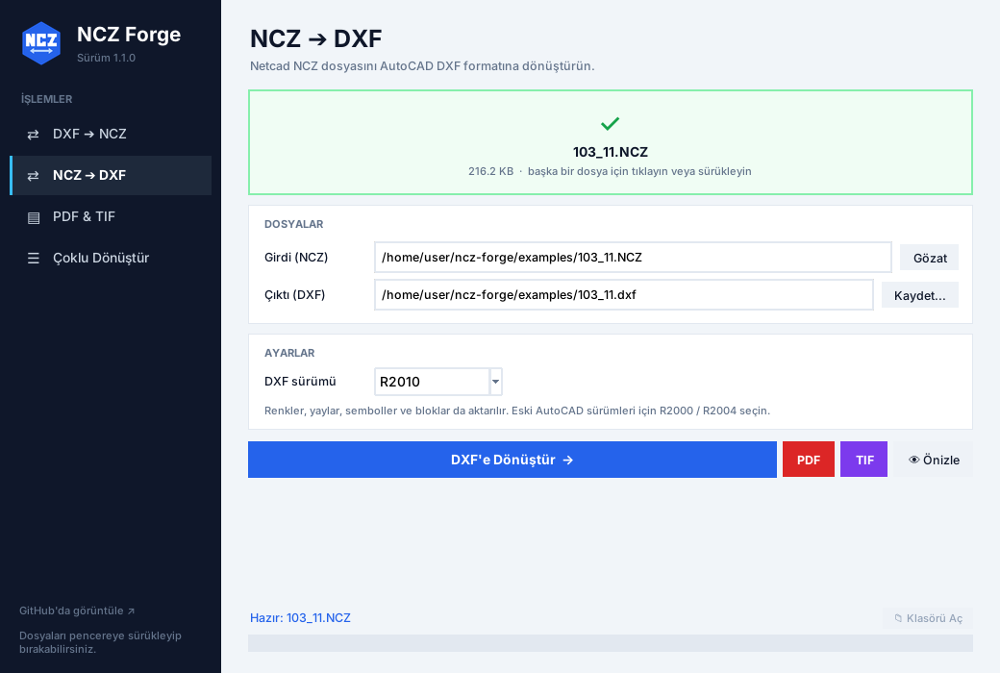

# NCZ Forge Wiki (English)

🇹🇷 *Türkçe için: [[Ana Sayfa|Home]]*

**NCZ Forge** is a free, open-source Windows program that converts Netcad **.NCZ** drawings to AutoCAD **DXF** (and back), exports them to **PDF / TIF**, and can process many files in one go.

> The program's interface is in Turkish. This guide gives the Turkish label of every button next to its English meaning.

## 🚀 Quick start

1. Download [**NCZ.Forge.exe**](https://github.com/evrek4/ncz-forge/releases/latest/download/NCZ.Forge.exe) (no installation needed).
2. Double-click it. If Windows shows *"Windows protected your PC"*, click **More info → Run anyway**.
3. Drag your NCZ or DXF file onto the window and press the convert button.

## 📚 Pages

| Page | Contents |
|---|---|
| [[Installation]] | Download, SmartScreen warning, running from source |
| [[User Guide\|User-Guide]] | Every screen of the program, step by step |
| [[Batch Conversion\|Batch-Conversion]] | Converting many files or whole folders at once |
| [[Command Line\|Command-Line]] | `ncz_tool.py` commands and options |
| [[Conversion Details\|Conversion-Details]] | What is converted and how; known limitations |
| [[Troubleshooting]] | FAQ, error log, known issues |
| [[NCZ File Format\|NCZ-File-Format]] | The NCZ binary format (technical) |
| [[Developer Guide\|Developer-Guide]] | Python API, tests, publishing a release |
| [[Release Notes\|Release-Notes]] | What changed in each version |

## 🔗 Links

- [Download the latest version](https://github.com/evrek4/ncz-forge/releases/latest)
- [Source code](https://github.com/evrek4/ncz-forge)
- [Report a bug / suggest a feature](https://github.com/evrek4/ncz-forge/issues)
