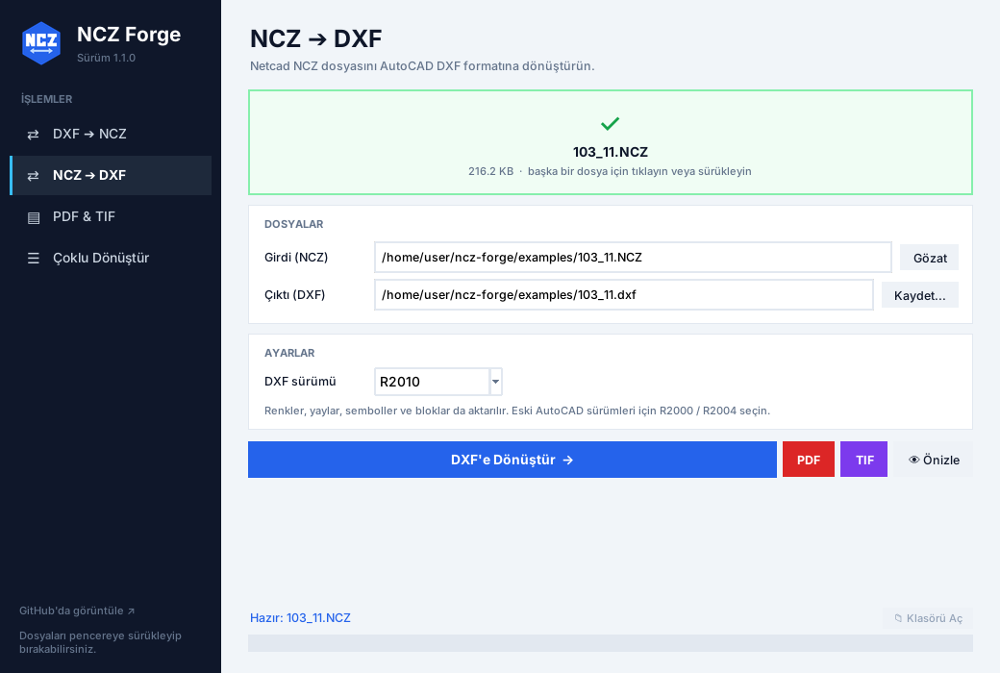

# NCZ Forge Wiki

🇬🇧 *English: [[Home (English)|English]]*

**NCZ Forge**, Netcad'in **.NCZ** çizim dosyalarını AutoCAD **DXF** formatına (ve tersine) dönüştüren, **PDF / TIF** çıktısı alan ve çok sayıda dosyayı tek seferde işleyebilen ücretsiz, açık kaynaklı bir Windows programıdır.

## 🚀 Hızlı başlangıç

1. [**NCZ.Forge.exe**](https://github.com/evrek4/ncz-forge/releases/latest/download/NCZ.Forge.exe) dosyasını indirin (kurulum gerekmez).
2. Çift tıklayarak açın. *"Windows bilgisayarınızı korudu"* uyarısı çıkarsa **Ek bilgi → Yine de çalıştır** deyin.
3. NCZ veya DXF dosyanızı pencereye sürükleyip bırakın ve dönüştür düğmesine basın.

## 📚 Sayfalar

| Sayfa | İçerik |
|---|---|
| [[Kurulum]] | İndirme, SmartScreen uyarısı, kaynak koddan çalıştırma |
| [[Kullanım Kılavuzu\|Kullanim-Kilavuzu]] | Arayüzün tüm sayfaları adım adım |
| [[Çoklu Dönüştürme\|Coklu-Donusturme]] | Birden fazla dosyayı / klasörü tek seferde dönüştürme |
| [[Komut Satırı\|Komut-Satiri]] | `ncz_tool.py` komutları ve seçenekleri |
| [[Dönüşüm Ayrıntıları\|Donusum-Ayrintilari]] | Hangi nesneler, renkler, semboller nasıl aktarılır; sınırlamalar |
| [[Sorun Giderme\|Sorun-Giderme]] | Sık sorulan sorular, hata kaydı, bilinen sorunlar |
| [[NCZ Dosya Formatı\|NCZ-Dosya-Formati]] | NCZ ikili dosya yapısı (teknik) |
| [[Geliştirici Rehberi\|Gelistirici-Rehberi]] | Python API, testler, yeni sürüm yayınlama |
| [[Sürüm Notları\|Surum-Notlari]] | Sürümlerde neler değişti |

## 🔗 Bağlantılar

- [Son sürümü indir](https://github.com/evrek4/ncz-forge/releases/latest)
- [Kaynak kod](https://github.com/evrek4/ncz-forge)
- [Hata bildir / öneri yap](https://github.com/evrek4/ncz-forge/issues)
