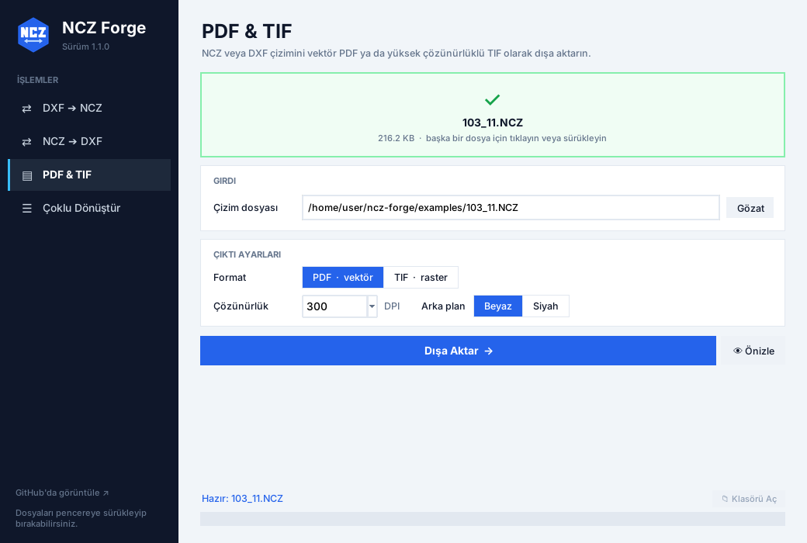

# Kullanım Kılavuzu

Program açıldığında solda işlem menüsü, sağda seçili işlemin sayfası bulunur. Her sayfada:

- **Sürükle-bırak alanı:** Dosyayı buraya (ya da pencerenin herhangi bir yerine) bırakın veya tıklayıp seçin. Dosya yüklenince alan yeşile döner.
- **Durum çubuğu (en alt):** İşlemin ilerlemesini ve sonucunu gösterir. İşlem bitince **📁 Klasörü Aç** ile çıktının bulunduğu klasörü açabilirsiniz.
- **👁 Önizle:** Çizimi dönüştürmeden önce ayrı bir pencerede gösterir. Büyüteç ile yakınlaştırın, el aracı ile kaydırın, ev simgesiyle başa dönün.

> Var olan bir dosyanın üzerine yazılacaksa program önce sorar.

---

## DXF ➔ NCZ

AutoCAD DXF çizimini Netcad NCZ dosyasına dönüştürür.

1. DXF dosyasını bırakın. **Çıktı (NCZ)** otomatik olarak aynı klasörde aynı adla doldurulur; değiştirmek için **Kaydet...** deyin.
2. **NCZ şablonu** (isteğe bağlı): Projeksiyon, sembol ve stil bilgilerinin alınacağı bir NCZ dosyası. Programla gelen örnek şablon varsayılan olarak seçilidir.
3. **X ve Y koordinatlarını yer değiştir:** Netcad'de çizim ters (Sağa/Yukarı karışmış) görünürse işaretleyin.
4. **NCZ'ye Dönüştür** düğmesine basın.

Aynı sayfadaki **PDF** / **TIF** düğmeleri DXF'i doğrudan 300 DPI, beyaz arka planla dışa aktarır.

## NCZ ➔ DXF

Netcad NCZ dosyasını AutoCAD DXF'e dönüştürür.

1. NCZ dosyasını bırakın.
2. **DXF sürümü:** Varsayılan R2010. Eski AutoCAD sürümleriyle açacaksanız R2000 / R2004 seçin.
3. **DXF'e Dönüştür** düğmesine basın.

Tabakalar, renkler, yazılar, yaylar, semboller ve bloklar aktarılır. Ayrıntılar: [[Dönüşüm Ayrıntıları|Donusum-Ayrintilari]].

## PDF & TIF

NCZ veya DXF dosyasını yazdırılabilir çıktıya dönüştürür.

| Ayar | Seçenekler | Açıklama |
|---|---|---|
| Format | **PDF** (vektör) / **TIF** (raster) | PDF her ölçekte keskindir; TIF LZW sıkıştırmalı resimdir |
| Çözünürlük | 150 / 300 / 600 DPI | TIF için piksel yoğunluğu |
| Arka plan | Beyaz / Siyah | Siyah, Netcad/AutoCAD ekran görünümüne benzer |

Çıktı, girdi dosyasıyla aynı klasöre aynı adla kaydedilir.

## Çoklu Dönüştür

Birden fazla dosyayı tek seferde işler. Ayrıntılı anlatım: [[Çoklu Dönüştürme|Coklu-Donusturme]].

---

## Sürükle-bırak ipuçları

| Ne bırakırsanız | Ne olur |
|---|---|
| Tek DXF | **DXF ➔ NCZ** sayfası açılır |
| Tek NCZ | **NCZ ➔ DXF** sayfası açılır |
| Birden fazla dosya veya bir klasör | **Çoklu Dönüştür** sayfası açılır ve dosyalar listeye eklenir |
| Herhangi bir dosya, *PDF & TIF* sayfası açıkken | O sayfaya yüklenir |
| Exe simgesinin üzerine dosya bırakmak | Program o dosya(lar)la açılır |
