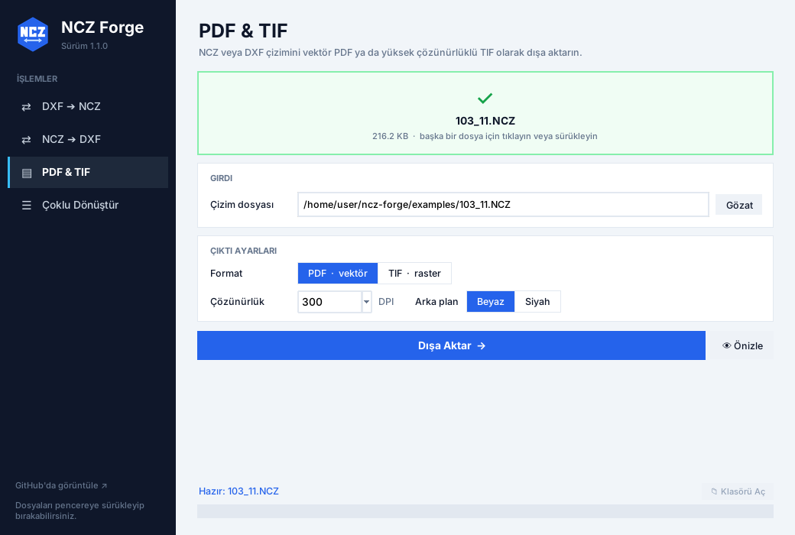

# User Guide

🇹🇷 *Türkçe: [[Kullanım Kılavuzu|Kullanim-Kilavuzu]]*

The window has an operations menu on the left (**İŞLEMLER**) and the selected page on the right. Every page has:

- **Drop zone:** Drop a file here (or anywhere on the window), or click to choose one. It turns green once a file is loaded.
- **Status bar (bottom):** Shows progress and the result. When finished, **📁 Klasörü Aç** (*Open folder*) opens the folder containing the output.
- **👁 Önizle** (*Preview*): Shows the drawing in a separate window before converting. Use the magnifier to zoom, the hand to pan, and the home icon to reset.

> If an output file already exists, the program asks before overwriting it.

---

## DXF ➔ NCZ

Converts an AutoCAD DXF drawing into a Netcad NCZ file.

1. Drop a DXF file. **Çıktı (NCZ)** (*Output*) is filled in automatically with the same name in the same folder; use **Kaydet...** (*Save as*) to change it.
2. **NCZ şablonu** (*NCZ template*, optional): an NCZ file whose projection, symbols and styles are reused. The bundled sample template is selected by default.
3. **X ve Y koordinatlarını yer değiştir** (*Swap X and Y*): tick this if the drawing appears rotated/mirrored in Netcad.
4. Press **NCZ'ye Dönüştür** (*Convert to NCZ*).

The **PDF** / **TIF** buttons on the same page export the DXF directly at 300 DPI with a white background.

## NCZ ➔ DXF

Converts a Netcad NCZ file into AutoCAD DXF.

1. Drop an NCZ file.
2. **DXF sürümü** (*DXF version*): R2010 by default. Choose R2000 / R2004 for older AutoCAD versions.
3. Press **DXF'e Dönüştür** (*Convert to DXF*).

Layers, colours, texts, arcs, symbols and blocks are transferred. Details: [[Conversion Details|Conversion-Details]].

## PDF & TIF

Exports an NCZ or DXF file for printing.

| Setting | Options | Notes |
|---|---|---|
| **Format** | **PDF** (vector) / **TIF** (raster) | PDF stays sharp at any zoom; TIF is an LZW-compressed image |
| **Çözünürlük** (*Resolution*) | 150 / 300 / 600 DPI | Pixel density for TIF |
| **Arka plan** (*Background*) | **Beyaz** (*White*) / **Siyah** (*Black*) | Black looks like the Netcad/AutoCAD screen |

Press **Dışa Aktar** (*Export*). The output is saved next to the input with the same name.

## Çoklu Dönüştür (Batch conversion)

Processes many files at once. See [[Batch Conversion|Batch-Conversion]].

---

## Drag-and-drop behaviour

| What you drop | What happens |
|---|---|
| A single DXF | The **DXF ➔ NCZ** page opens |
| A single NCZ | The **NCZ ➔ DXF** page opens |
| Several files, or a folder | The **Çoklu Dönüştür** page opens and the files are added to the list |
| Any file while *PDF & TIF* is open | It is loaded into that page |
| Files dropped onto the exe icon | The program starts with those files |
